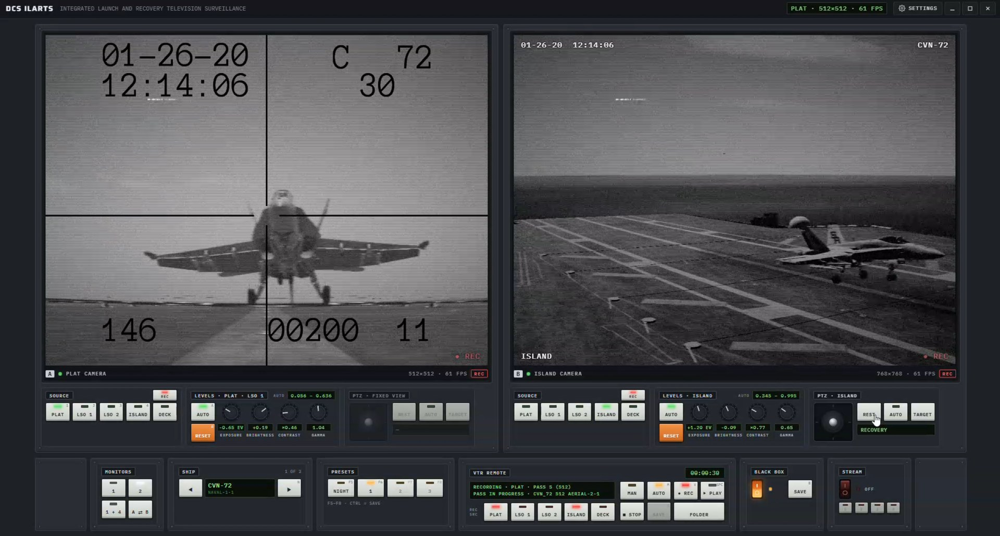

# DCS ILARTS

**The carrier's closed-circuit TV station for DCS World Supercarrier.** You get the PLAT camera, both LSO station
screens and the deck cameras in their own window on your desktop, from anywhere in the mission. You never have to
go to the LSO platform. Every approach is recorded and named after the pilot, the case and the LSO's grade. Instant
replay, a black box and live outputs to OBS, Discord and streaming services are included.

> DCS ILARTS is an independent community mod. Eagle Dynamics does not make, support or endorse it. DCS World and
> Supercarrier are trademarks of Eagle Dynamics SA.

## Who it is for

- **LSOs and paddles** who grade passes and want the PLAT and the LSO screens while flying or spectating, without
  occupying the LSO station.
- **Squadron training officers** who want every trap, bolter and wave-off on video, named and ready for the debrief.
- **Carrier air wing streamers** who want a PLAT feed on stream, a multi-camera composite, or a webcam into Discord.
- **Anyone who likes watching recoveries.** It is a carrier TV station on your second screen.

## What it does

| | |
|---|---|
| **PLAT and LSO screens, anywhere** | The PLAT camera (ILARTS), the LSO station screen and the cue panel run from mission start. You can be in a cockpit, on another ship or in the F10 map. |
| **Deck cameras** | An island camera follows each landing aircraft from the round down. Deck positions include the bow bubble, catapult 1, the crotch, elevators 1-3, the corral, the waist bubble and the junkyard. Pan, tilt and zoom them with an on-screen joystick. Each camera on screen costs DCS frame rate, so show only the ones you need. |
| **Console** | Laid out like the ship's station: monitor A (program), monitor B or four previews, levels, PTZ, a VTR remote, presets and a ship selector. The layout fills any window shape. |
| **Automatic pass recording** | Each approach goes into its own MP4, from just before the groove until a few seconds after the trap, bolter or wave-off. The file is named like `2026-11-13 21-04-10 Viper Case III (OK) wire 3 PLAT.mp4`. Recordings stay under 20 MB, so they fit Discord. |
| **Instant replay** | Replay the last pass: pause, step frame by frame, slow motion, save. |
| **Black box** | Always keeps the last minutes. A crash, ejection or lost aircraft near the carrier saves itself. |
| **Streaming** | Up to four RTMP streams (Twitch, YouTube, your own server), each with its own source or a 1080p composite of up to four cameras. |
| **OBS and Discord** | Spout senders for OBS, and Windows 11 virtual webcams for Discord, Teams and Zoom. |
| **CCTV look** | Optional scan lines, noise and lens distortion, as on a ship's monitor. You can choose to apply it to recordings only. |
| **Experimental: FLIR** | Off by default (SETTINGS > Experimental). A FLIR key on each camera shows DCS's infrared picture. ⚠ Costs DCS considerably more frame rate than the normal view. |
| **Repair** | One click restores the hook and DCS's permissions after a DCS update and checks DCS compatibility. |

## Requirements

- DCS World **2.9.31.29434** with the **Supercarrier** module. ILARTS checks the DCS version at each mission start
  and switches itself off on a version it does not know. DCS continues to operate normally.
- Windows 10 or 11, 64-bit. The console uses the Microsoft Edge WebView2 runtime, which Windows 11 already has.
  Virtual webcams need Windows 11.
- Single player, multiplayer host, or multiplayer client. A client needs a server that allows object export.
  As a client you get no LSO grades in the file names, and crashes and ejections do not save the black box by
  themselves: DCS reports those events to the host only. Everything else works.

> [!WARNING]
> **Not tested with other mods.** DCS ILARTS has not been tested for compatibility with any other mod: aircraft,
> terrain, shader or sound mods, or tools that hook into DCS's graphics (ReShade, VR toolkits, overlays). If DCS or
> another mod misbehaves with ILARTS installed, disable your other mods to find the conflict, then report it with
> the log.

## Install

Download one of these from [Releases](../../releases):

| File | For |
|---|---|
| `DCS-ILARTS-Setup-<version>.exe` | Most users. Installs into `Saved Games\DCS` and sets up DCS's permissions. Adds Start menu entries and an uninstaller. Can also install the virtual webcams. |
| `DCS-ILARTS_v<version>.zip` | [Open Mod Manager (OMM)](https://github.com/iquercorb/OpenModMan): add it to your DCS channel's library. |
| `DCS-ILARTS.zip` (OvGME) | OvGME / JSGME, or a manual install: copy `Mods` and `Scripts` into `Saved Games\DCS`. |

> [!IMPORTANT]
> **Installed from a zip (OMM, OvGME or by hand)? One more step, or ILARTS will not work in single player or when
> you host.** Start `Saved Games\DCS\Mods\tech\ILARTS\bin\ILARTS.exe` once. It says *"DCS ILARTS is not set up
> yet"*: click **Yes**. That adds the two `autoexec.cfg` permissions the hook needs, on top of what other mods allow
> (the file is backed up first). The setup program does this for you.

Then start DCS and load a mission with a carrier. **ILARTS does not open when DCS starts:** its window opens by itself
about 10 seconds after the mission has loaded (switch off SETTINGS > Window > *Start with DCS* if you would rather
open it yourself).

**After a DCS update:** run **REPAIR** (SETTINGS > Installation, or Start menu > *DCS ILARTS - Repair*).

**Uninstall:** the setup program's uninstaller removes everything, including the `autoexec.cfg` permissions. With OMM
or OvGME, first click SETTINGS > Installation > DCS permissions > **REMOVE** (and Outputs > Camera component >
**REMOVE** if you installed the webcams), then disable the mod.

## Documentation

- [User guide (PDF)](docs/DCS-ILARTS-Guide.pdf): the console, the controls and every setting.
- [`deploy/README.txt`](deploy/README.txt): the full reference that ships with the mod (keys, recording names,
  `ILARTS.ini`).
- [`docs/DEVELOPMENT.md`](docs/DEVELOPMENT.md): build, internals and tests.

## Say thanks

DCS ILARTS is free. If you want to say thank you for it, please consider a donation to the
[Pilot Mental Health Campaign](https://www.pmhc.org/), which works to make it easier for pilots to get mental health care.

## License

[MIT](LICENSE). Third-party code in `third_party/` keeps its own license (the `LICENSE.txt` in each folder), and the
fonts in `ui/fonts/` are under the SIL Open Font License (the `OFL-*.txt` files there).

## AI disclosure

DCS ILARTS was built with the help of AI tools (Claude, by Anthropic). The author designed it, directed the
work and tested it in DCS.

## Problems

[Open an issue](https://github.com/Nubs-dev/DCS-ILARTS/issues) and attach the log: `%LOCALAPPDATA%\ILARTS\ILARTS.log`.
