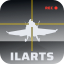
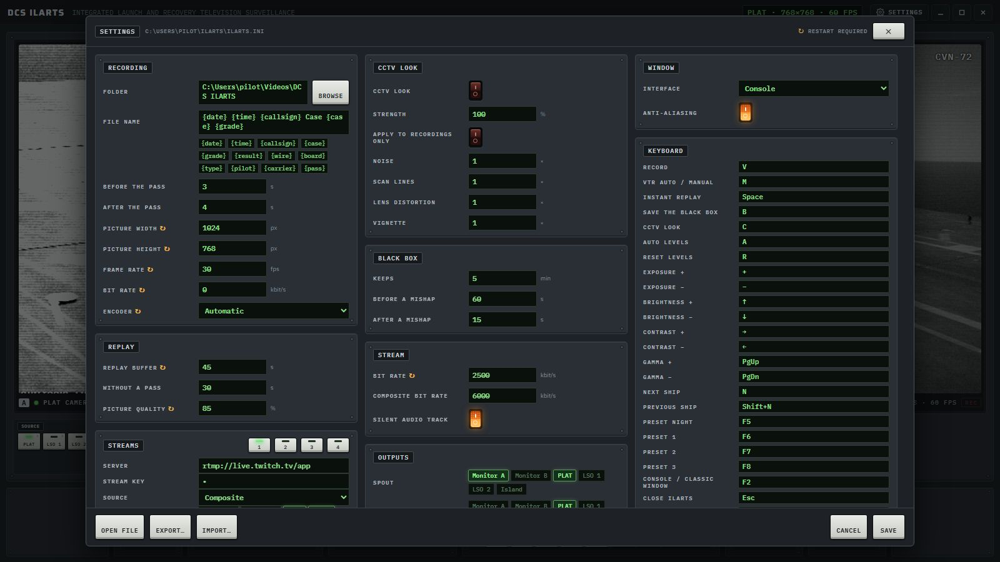

# <picture><source media="(prefers-color-scheme: dark)" srcset="assets/ILARTS-icon-light-64.png"></picture> DCS ILARTS

**The carrier's closed-circuit TV station for DCS World Supercarrier.** You get the PLAT camera, both LSO station
screens and the deck cameras in their own window on your desktop, from anywhere in the mission. You never have to
go to the LSO platform. Every approach is recorded and named after the pilot, the case and the LSO's grade. Instant
replay, a black box and live outputs to OBS, Discord and streaming services are included.

> DCS ILARTS is an independent community mod. Eagle Dynamics does not make, support or endorse it. DCS World and
> Supercarrier are trademarks of Eagle Dynamics SA.

## Who it is for

- **LSOs and paddles** who grade passes and want the PLAT and the LSO screens while flying or spectating, without
  occupying the LSO station.
- **Squadron training officers** who want every trap, bolter and wave-off on video, named and ready for the debrief.
- **Carrier air wing streamers** who want a PLAT feed on stream, a multi-camera composite, or a webcam into Discord.
- **Anyone who likes watching recoveries.** It is a carrier TV station on your second screen.

## What it does

| | |
|---|---|
| **PLAT and LSO screens, anywhere** | The PLAT camera (ILARTS), the LSO station screen and the cue panel run from mission start. You can be in a cockpit, on another ship or in the F10 map. |
| **Deck cameras** | An island camera follows each landing aircraft from the round down. Deck positions include the bow bubble, catapult 1, the crotch, elevators 1-3, the corral, the waist bubble and the junkyard, and six in the hangar bay: both ends and opposite each of the four elevators. The lists show them under FLIGHT DECK and HANGAR DECK. Pan, tilt and zoom them with an on-screen joystick; the hangar cameras don't track (no AUTO). CYCLE steps a monitor through the deck positions you tick, on a timer. Each camera on screen costs DCS frame rate, so show only the ones you need. |
| **Console** | Laid out like the ship's station: monitor A (program), monitor B or four previews, levels, PTZ, a VTR remote, presets and a ship selector. The layout fills any window shape. |
| **Automatic pass recording** | Each approach goes into its own MP4, from just before the groove until a few seconds after the trap, bolter or wave-off. The file is named like `2026-11-13 21-04-10 Viper Case III (OK) wire 3 PLAT.mp4`. Recordings stay under 20 MB, so they fit Discord. With COMP on, each recording is one 1080p composite of the recorded sources instead of a file per source. The ACFT key chooses whose approaches: your aircraft, your section, your flight or all. |
| **Instant replay** | Replay the last pass: pause, step frame by frame, slow motion, save. |
| **Stills** | One key saves a PNG of each recorded source (or one composite with COMP on), named with the DCS mission time. |
| **A folder per mission** | Recordings, black box files, saved replays and stills go into one folder for each mission, named like `2026-11-17 1432 Case I recovery`. An optional storage limit deletes the oldest recordings when the folder gets too big. |
| **Black box** | Always keeps the last minutes. A crash, ejection or lost aircraft near the carrier saves itself. |
| **Streaming** | Up to four RTMP streams (Twitch, YouTube, your own server), each with its own source or a 1080p composite of up to four cameras. |
| **OBS and Discord** | Spout senders for OBS, and Windows 11 virtual webcams for Discord, Teams and Zoom. |
| **CCTV look** | Scan lines, noise and lens distortion, as on a ship's monitor. On by default (key C); you can choose to apply it to recordings only. |
| **Experimental: FLIR** | Off by default (SETTINGS > Experimental). A FLIR key on each camera shows DCS's infrared picture. ⚠ Costs DCS considerably more frame rate than the normal view. |
| **Benchmark** | SETTINGS > Benchmark > *Benchmark next mission*: at the next mission start ILARTS measures what it costs your PC, stage by stage (DCS with only the hook, with the PLAT and LSO screens, then 1 to 5 camera views with recording off and on), and writes a report: average frame rate, 1% and 0.1% lows, each as a change against DCS alone, e.g. "−15 fps · +2.3 ms · −13%". |
| **Repair** | One click restores the hook and DCS's permissions after a DCS update and checks DCS compatibility. |

## Requirements

- DCS World **2.9.31.29434** with the **Supercarrier** module. ILARTS checks the DCS version at each mission start
  and switches itself off on a version it does not know. DCS continues to operate normally.
- Windows 10 or 11, 64-bit. Virtual webcams need Windows 11.
- The Microsoft Edge WebView2 Runtime. ILARTS's window is built on it. Windows 11 and an up-to-date Windows 10
  already have it. Without it, ILARTS does not open: it says the runtime is missing and offers Microsoft's
  [download page](https://developer.microsoft.com/microsoft-edge/webview2/). Install the "Evergreen Bootstrapper"
  from there, then start ILARTS again. There is no other interface to fall back on.
- Single player, multiplayer host, or multiplayer client. A client needs a server that allows object export.
  As a client you get no LSO grades in the file names, and crashes and ejections do not save the black box by
  themselves: DCS reports those events to the host only. Everything else works.

> [!WARNING]
> **Not tested with other mods.** DCS ILARTS has not been tested for compatibility with any other mod: aircraft,
> terrain, shader or sound mods, or tools that hook into DCS's graphics (ReShade, VR toolkits, overlays). If DCS or
> another mod misbehaves with ILARTS installed, disable your other mods to find the conflict, then report it with
> the log.

## Install

Download one of these from [Releases](../../releases):

| File | For |
|---|---|
| `DCS-ILARTS-Setup-<version>.exe` | Most users. Installs into `Saved Games\DCS` and sets up DCS's permissions. Adds Start menu entries and an uninstaller. Can also install the virtual webcams. |
| `DCS-ILARTS_v<version>.zip` | [Open Mod Manager (OMM)](https://github.com/iquercorb/OpenModMan): add it to your DCS channel's library. |
| `DCS-ILARTS.zip` (OvGME) | OvGME / JSGME, or a manual install: copy `Mods` and `Scripts` into `Saved Games\DCS`. |

> [!NOTE]
> The OvGME / JSGME installation is not tested. If you use it, give feedback and report problems in the
> #ilarts-issues forum on [Discord](https://discord.gg/qsjedwKHNr).

> [!IMPORTANT]
> **Installed from a zip (OMM, OvGME or by hand)? One more step, or ILARTS will not work in single player or when
> you host.** Start `Saved Games\DCS\Mods\tech\ILARTS\bin\ILARTS.exe` once. It says *"DCS ILARTS is not set up
> yet"*: click **Yes**. That adds the two `autoexec.cfg` permissions the hook needs, on top of what other mods allow
> (the file is backed up first). The setup program does this for you.

Then start DCS and load a mission with a carrier. **ILARTS does not open when DCS starts:** its window opens by itself
as soon as the mission has loaded, and the pictures follow about 20 seconds later (switch off SETTINGS > Window > *Start with DCS* if you would rather
open it yourself).

**After a DCS update:** run **REPAIR** (SETTINGS > Installation, or Start menu > *DCS ILARTS - Repair*).

**Updates:** once a day ILARTS asks GitHub whether there is a newer release. When there is, a download icon and **1.1.0 AVAILABLE**
(the new version) appear in the title bar; click it for **INSTALL**, **RELEASE NOTES** or **SKIP THIS VERSION**. INSTALL
downloads the setup program, checks that it is the one published with the release, closes ILARTS, runs the setup with
your earlier choices and starts ILARTS again. Close DCS first: DCS holds ILARTS's files while it runs. Installed with
OMM or OvGME, the menu offers **RELEASE PAGE** instead: download the new zip there. To turn it off: SETTINGS >
Installation > *Check for updates*, or untick *Check for updates* in the setup program.

**Uninstall:** the setup program's uninstaller removes everything, including the `autoexec.cfg` permissions. With OMM
or OvGME, first click SETTINGS > Installation > DCS permissions > **REMOVE** (and Outputs > Camera component >
**REMOVE** if you installed the webcams), then disable the mod.

## Benchmark

To see what ILARTS costs DCS on your PC, switch on SETTINGS > Benchmark > *Benchmark next mission* and start a
mission. It runs once, for about six minutes, then switches itself off. How to get numbers you can compare (also the
**i** beside the Benchmark panel's name):

- Load `Missions\ILARTS Benchmark.miz` (installed with ILARTS), a calm, repeatable scene: parked on deck in the
  cockpit of an F/A-18C on CVN-71. Don't fly.
- Keep DCS in front. Don't touch the controls, change the view or pause.
- It starts 10 seconds after the mission is running (unpaused, you in your aircraft) and takes about six minutes.
- Compare each stage with *Hook only*. Two runs differ by a few percent.

ILARTS changes cameras by itself meanwhile, and the status display shows the stage. A lamp in the title bar shows the
benchmark: steady green when it is armed, flashing amber while it runs, steady green when the report is ready, red
if it stopped (its tooltip says why). Click it after a run to open the report; that also puts the lamp out. While
DCS is paused the benchmark waits: paused frames don't count. The stages, each measured for 20 seconds after a few
seconds to settle:

1. **Hook only**: DCS with the ILARTS hook loaded and nothing else of ILARTS started.
2. **PLAT, LSO 1, LSO 2**: ILARTS started as usual, no cameras.
3. **1 view** to **5 views**: the island camera, then deck positions, each count once with recording off and once with every source shown recorded (the PLAT and each view). These recordings are encoded like real ones but nothing is saved.

Leaving the mission, changing aircraft or slot, or closing ILARTS stops the run; what was measured is still reported.
Your cameras, monitors and REC switches are as before afterwards. No pass is recorded while the benchmark runs.

The report is a web page (and a JSON file) in `%LOCALAPPDATA%\ILARTS\benchmarks`; SETTINGS > Benchmark > Last report
> **OPEN** shows the newest. For each stage it gives the average frame rate and the 1% and 0.1% lows (the frame
rates that 99% and 99.9% of the frames beat), each with its change against stage 1: "−15 fps · +2.3 ms · −13%". The
scene in a running mission keeps changing, so differences of a few percent can be noise.

## Performance

Every picture ILARTS shows is one DCS draws: the PLAT and LSO screens are DCS's own exports, and each island or deck
camera makes DCS draw the scene once more. That is where nearly all of ILARTS's cost is, on the graphics card and
DCS's render thread. ILARTS itself (the viewer, recording, the black box) uses a few percent of the processor.

The benchmark on two PCs, from the benchmark mission (parked on deck in an F/A-18C), average / 1% low:

| | Laptop: RTX 5070 Ti Laptop GPU, Core Ultra 9 275HX, DCS at 2560 × 1600 | Desktop: RTX 5090, Ryzen 7 9800X3D, DCS at 9984 × 1744 (three cockpit viewports, five MFD / RWR / IFEI exports) |
|---|---|---|
| Hook only | 127 / 109 fps | 104 / 80 fps |
| PLAT, LSO 1, LSO 2 | 101 / 65 fps (−21% avg) | 86 / 59 fps (−17% avg) |
| 1 view | 82 / 60 fps (−36%) | 80 / 57 fps (−23%) |
| 2 views | 73 / 57 fps (−43%) | 67 / 53 fps (−36%) |
| 3 views | 62 / 49 fps (−52%) | 49 / 40 fps (−52%) |
| 4 views | 52 / 38 fps (−60%) | 43 / 35 fps (−59%) |
| 5 views | 51 / 39 fps (−60%) | 43 / 36 fps (−58%) |
| 5 views, all recorded | 49 / 35 fps (−61%) | 37 / 30 fps (−64%) |

These numbers set expectations; they are not a comparison of the two PCs. Their DCS graphics settings differ, and
the desktop also draws three cockpit viewports and five cockpit display exports.

What they show:

- **The PLAT, LSO and camera pictures cost the most.** With the exports and three views, both PCs ran at about half
  the frame rate they had with the hook only.
- **Recording costs less than a view:** up to 2 fps on the laptop, 5 to 8 fps on the desktop from two views on.
  ILARTS's own processor use rose from about 2% to 11% with six sources recorded.
- **The lows drop more than the average.** If DCS feels less smooth, the 1% low is the number to watch.

To keep DCS fast:

- A camera runs only while something uses it: shown on a monitor or as a preview, recorded, streamed, sent to OBS
  (Spout) or used as a webcam. Show only what you watch: layout 1, or previews set to none.
- Spout senders and virtual cameras keep their picture's camera running while they're on.
- Run the benchmark on your own PC: your settings, resolution and graphics card decide the numbers.

## Documentation

- [User guide (PDF)](docs/DCS-ILARTS-Guide.pdf): the console, the controls and every setting. The **?** key in
  ILARTS's title bar opens it. The same guide as a web page: `DCS-ILARTS-Guide.html`, next to the PDF in the mod
  folder and on each release.
- [`deploy/README.txt`](deploy/README.txt): the full reference that ships with the mod (keys, recording names,
  `ILARTS.ini`).
- [`docs/DEVELOPMENT.md`](docs/DEVELOPMENT.md): build, internals and tests.

## Say thanks

DCS ILARTS is free. If you want to say thank you for it, please consider a donation to the
[Pilot Mental Health Campaign](https://www.pmhc.org/), which works to make it easier for pilots to get mental health care.

## Privacy

DCS ILARTS collects no data: no telemetry, no account. Everything it makes (recordings, stills, settings, the log)
stays on your PC. It connects to the network for two things only: an RTMP stream you set up yourself, to the server
you enter, and the check for updates (unless you switch it off): once a day it asks GitHub's public API for the newest
release of DCS ILARTS, sending nothing about you or your PC (a generic `ILARTS-updater/<version>` user agent, no
account), and downloads the setup program from GitHub when you click INSTALL. The log
(`%LOCALAPPDATA%\ILARTS\ILARTS.log`) can show your Windows user name in file paths; it only leaves your PC if you
attach it to a bug report. The window is drawn by Microsoft's WebView2 runtime, which follows your Windows
diagnostic data settings.

## License

[MIT](LICENSE). Third-party code in `third_party/` keeps its own license (the `LICENSE.txt` in each folder), and the
fonts in `ui/fonts/` are under the SIL Open Font License (the `OFL-*.txt` files there).

## Code signing

Free code signing provided by [SignPath.io](https://about.signpath.io), certificate by
[SignPath Foundation](https://signpath.org). See the [code signing policy](docs/CODE-SIGNING.md).

## AI disclosure

DCS ILARTS was built with the help of AI tools (Claude, by Anthropic). The author designed it, directed the
work and tested it in DCS.

## Limitations and known issues

Some parts of the picture DCS works out only for the **main viewport** (the view on your screen) at **your player
location** (where you are in DCS: in an aircraft, at the LSO or Air Boss station, and so on). The PLAT and ILARTS's
cameras are separate views and don't get them. So:

- **No sun shadows** in the PLAT or the cameras, even with you at the LSO station (the island's shadow on the deck, for
  example). DCS draws sun shadows for the main viewport only; DCS's own PLAT has none either.
- **The deck's light:** DCS works out reflections and sky light at your player location and uses them for every view,
  so when you are far from the carrier the deck in the PLAT and the cameras can look darker or flatter than when you are
  near it, most visibly in overcast and rain.
- **Weather beyond 200 km:** DCS keeps cloud data only for 200 km around your player location, so with the carrier farther
  away the PLAT and the cameras can show different clouds and rain than the carrier really has.
- **Rain:** in a warm mission the cameras' rain is lighter while your player location is at about 2.5-3.5 km (DCS turns part
  of it into snow for every view when it is near freezing there); under time acceleration the streaks are longer.
- **Multiplayer clients** get no LSO grades in file names and no automatic black box save after a crash or ejection
  (DCS sends those events to the host only).

## Problems

ILARTS says it "can't run on this PC yet" and needs the Microsoft Edge WebView2 Runtime: click Yes, install the
Evergreen Bootstrapper from Microsoft's page, then start ILARTS again. If ILARTS says the console stopped working,
start it again; if that keeps happening, reinstall the WebView2 Runtime from the same page.

[Open an issue](https://github.com/Nubs-dev/DCS-ILARTS/issues) with your ILARTS version (SETTINGS > Installation > Version)
and attach the log: `%LOCALAPPDATA%\ILARTS\ILARTS.log` (SETTINGS > Installation > Logs > **OPEN** opens its folder).
For a frame rate problem, a benchmark report helps too (see Benchmark above).
You can also report bugs in the #ilarts-issues forum on [Discord](https://discord.gg/qsjedwKHNr).
